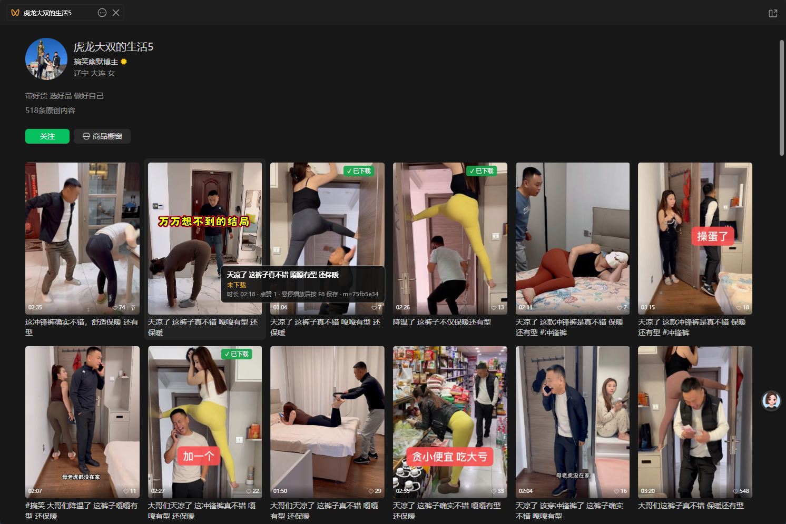

# wx_video_downloader

微信视频号（WeChat Channels）视频下载工具，面向 **微信 PC 4.2.x**。

在 4.2 里，视频号已经换成**原生 liteapp**：没有网页可注入、下载密钥不走网络，传统“代理 + 注入按钮”的方案全部失效。本项目换了一条路：

> 用透明代理拿到视频地址 → 从这个视频**播放时的微信进程内存**里取出解密后的 MP4 头 → 和密文尾部拼接 → 全片校验后保存。

## 特性

- ✅ 微信 4.2.x 可用（4.2.0.13 实测）
- ✅ 两种用法：`wx-dl.cmd` 自动下载，或 `wx-save.cmd` 悬停卡片 + F8 精确保存
- ✅ 已下载卡片显示 **✓ 已下载** 徽标，不用重复下
- ✅ 不需要改微信、不降级、不装驱动
- ✅ 不需要手动复制 URL、不需要 Fiddler/Charles
- ✅ 下载完成前做全片解码校验，不给你坏文件
- ✅ 退出或直接关窗口都会自动还原系统代理
- ✅ 只代理本机流量，证书只装进「当前用户」，不需要管理员

## 环境要求

| 依赖 | 说明 |
|---|---|
| Windows 10/11 | 需要 `curl.exe`（系统自带） |
| 微信 PC 4.2.x | 已在 4.2.0.13 验证 |
| PowerShell 5.1 或 7+ | 启动器优先用 `pwsh` |
| [mitmproxy](https://mitmproxy.org/) | 提供 `mitmdump`；`pip install mitmproxy` |
| ffmpeg / ffprobe | 用于解码校验；需在 PATH 中 |

## 参数

| 参数 | 默认 | 说明 |
|---|---|---|
| `-OutDir` | `我的文档\视频号` | 输出目录 |
| `-Port` | `8898` | mitmproxy 监听端口 |
| `-Upstream` | `auto` | 上游代理；auto 表示沿用当前系统代理（**仅当系统代理已启用、且那个本机端口确实在监听**时才会链上去，否则直连）、传空串表示直连 |
| `-SelfTest` | - | 只启动并自检，不进入监听 |
| `-KeepProxy` | - | 退出时不还原系统代理 |
| `-NoAuto` | - | 只监听、不自动下载；配合 `wx-hud` 的 F8 使用 |
| `-Hud` | - | 启动 `wx-hud` 并托管它的生命周期；配合 `-NoAuto` 即“悬停 + F8”模式 |

```powershell
powershell -ExecutionPolicy Bypass -File wx-dl.ps1 -OutDir "D:\视频号" -Port 8899
```

## 快速开始

```powershell
# 1) 环境检查 + 生成并安装根证书（只需一次）
powershell -ExecutionPolicy Bypass -File setup.ps1
```

**2）选一种用法：**

| 用法 | 入口 | 适合 |
|---|---|---|
| 自动下载 | 双击 **`wx-dl.cmd`** | 边看边存、不介意多下 |
| 悬停 + F8 精确保存 | 双击 **`wx-save.cmd`** | 只存你选中的视频 |

两种模式第一次启动后，都要把**微信完全退出再打开一次**（微信会缓存系统代理，不重开流量不经过代理）。

## 两种模式怎么选

|  | `wx-dl.cmd` 自动模式 | `wx-save.cmd` 悬停 + F8 |
|---|---|---|
| 下载范围 | 播放/预加载到的所有视频 | 只有按 F8 的那张卡片 |
| 需要操作 | 播放即可 | 悬停卡片 2～3 秒后按 F8 |
| 播放窗口 | 支持 | **不支持**（避免把预加载的下一条存错） |
| 流量 | 全量重复下载 | 只下选中的 |
| 适合 | 批量、播放窗口、懒得挑 | 精确保存、只要几条 |

> 两个入口不要同时运行：它们都要占用 `8898` 端口。切换前先关闭当前控制台（代理会自动还原）。

## 自动模式：`wx-dl.cmd`

双击 **`wx-dl.cmd`**，或在仓库目录执行：

```powershell
.\wx-dl.cmd
```

然后：

1. **完全退出微信，再打开**（微信会缓存系统代理，每次启动工具后需要重开一次）；
2. 进入视频号，点开视频，**播放 3~10 秒**；
3. 十几秒后文件出现在 `我的文档\视频号\`，形如 `视频号_20261110_133739_1080p_162s.mp4`；
4. 换下一个视频继续播即可；同一个视频只处理一次；
5. 停止：按 `Ctrl+C` 或直接关闭窗口（系统代理会自动还原）。

自动模式在**视频播放窗口**里也能工作；代价是微信预加载/播放到的视频都会被下载，而且会重新下载一遍（不复用微信已缓存的分片）。

## 悬停 + F8 精确保存：`wx-save.cmd`

双击 **`wx-save.cmd`**。它等价于：

```powershell
.\wx-dl.cmd -NoAuto -Hud
```

它会启动监听、拉起 HUD，并在同一个控制台里运行。第一次启动监听后，微信需要**完全退出再重开**（微信会缓存系统代理）。



操作：

1. 打开作者主页（卡片网格页）；
2. 鼠标悬停目标卡片 **2～3 秒**，让微信开始播放；
3. 按 **F8**；
4. HUD 显示“保存中…”→“✓ 已保存”，卡片变绿并出现 **✓ 已下载** 徽标。

说明：

- **只支持作者主页卡片页**；视频播放窗口没有卡片网格，HUD 不显示提示、F8 也不保存——那里请用自动模式，避免把预加载的下一条存成当前视频；
- 卡片页可以是独立窗口，也可以是内嵌在微信主窗口/播放窗口里的子页：HUD 会遍历所有微信顶层窗口，按光标/前台窗口选当前这个；
- 悬停提示在离开卡片后会**停留 4 秒**（`-LingerSeconds` 可调，例如 `-LingerSeconds 8`）；
- 已下载卡片在封面右上角显示绿色 **✓ 已下载**（透明覆盖层，点击穿透）；只标记完整落在可视区里的卡片，滚出视窗的不显示；
- F8 优先用悬停这张卡时绑定的媒体；没有绑定时按“开始时间 + 最近 Range 位置”排序，最多尝试 3 条候选，第一条失败自动换下一条；
- 保存过程中 HUD 显示 `wx-dl` 的最新进度（下载密文、大小、扫描内存、全片校验）；完成/失败后显示结果和文件名；
- 精确索引写在 `work\hud_index.json`，按 `m=`/`encfilekey` 和卡片文案/时长对应；没有索引时回退到输出文件名的时长匹配；
- **关闭控制台**（或 Ctrl+C）会同时停掉 HUD、监听进程并还原系统代理。

> PowerShell 里运行当前目录的脚本要加 `.\`，例如 `.\wx-dl.cmd -NoAuto`；直接敲 `wx-dl.cmd` 会被“命令找不到”挡住。双击 `.cmd` 没有这个问题。

诊断：

```powershell
pwsh -Sta -File wx-hud.ps1 -Diagnose     # 只打印识别到的卡片，不显示浮层
pwsh -Sta -File wx-hud.ps1 -OutDir "D:\视频号"
```

HUD 是只读覆盖层，不修改微信页面。

## 工作原理（简述）

```
微信(WeChatAppEx) ──HTTPS──> mitmproxy(只记录、不改写) ──> finder.video.qq.com
                                    │
                                    └─ flows.log ──> 发现视频地址 ──> 下载密文
微信播放 ──> 明文 MP4 头留在进程内存 ──> 按 ftyp+moov 扫描 ──> 取出 131072 字节
                                                                    │
                                          明文头 + 密文尾部 ──> 全片解码校验 ──> 保存
```

细节见 [docs/how-it-works.md](docs/how-it-works.md)。

## 常见问题

**播放窗口按 F8 没反应**
这是设计如此：视频播放窗口没有卡片网格，无法可靠区分“当前视频”和微信预加载的下一条，HUD 不显示提示、也不保存。请在播放窗口改用 `wx-dl` 自动模式，或回到作者主页悬停这张卡片再按 F8。

**播放了但没反应**
微信没有走新代理。请完全退出微信（任务管理器确认 `Weixin.exe` 都没了）再打开。

**微信里一律显示 `Bad Gateway` / `502`**
这是代理链到了**不存在的上游**：系统代理曾被指向某个本机端口（例如关掉 v2rayN 后残留在注册表里的 `127.0.0.1:8899`），mitmproxy 把请求转给这个死端口，于是整页 502。
现在的版本会自动判断：系统代理未启用、上游不在监听、或上游端口就是本工具端口时，都直接走直连。启动时会打印一行「上游判定：…」，正常应是 `系统代理当前未启用，直连` 或 `链式上游 127.0.0.1:10808`。
如果你确实需要走代理，用 `-Upstream 127.0.0.1:10808` 显式指定（也会先探测，连不上就回退直连并给出提示）。

**提示「没找到匹配的明文头」**
内存里只保留最近播放过的视频头。把这条视频重新播放几秒，再等它重试。

**提示「候选头都是别的视频的头」**
同一时刻内存里有多条视频的头，工具会逐个做结构比对，对不上的会打印「跳过候选 …（这是别的视频的头）」。这说明本条视频的明文头还没进内存，重播几秒即可；如果三次都这样，通常是播放时间太短、还没走到解密那一步。

**播了第二条之后就没反应了**
早期版本靠 URL 里的 `m=` 参数认视频，实测只有"你点开的那条"带 `m=`，信息流里其它视频的地址 `m=` 是空的，整条被丢掉（一次运行里 1050 行这么丢掉）。现在 `m=` 缺失时退到 `encfilekey`（同一条视频的所有分片共用它）来认，并且要求这条视频被请求过 3 次以上才开工，以区分"真正在播放"和信息流预加载的封面/下一条。

**下载了很多条，只成功一两个**早期版本有两条硬伤，现已修掉：

1. 内存里多份头同时存在时，只试第一个，取错头就整条失败——现在整段头的 MD5 去重 + 结构闸门挑选，逐个候选隔离试错；
2. 把 `ffmpeg` 对 B 帧 DTS 顺序的抱怨（`non monotonically increasing dts`）当成"文件坏了"——现在这类消息不计入错误。

如果仍然只成功少数几条，看 `work\run.log`：里面有每个候选的跳过原因（结构差多少、解码错误几行），以及 curl 是否中途断开。

**窗口一闪就没了**
用 `cmd` 打开仓库目录执行 `wx-dl.cmd`，把报错发到 issue。

**退出后上不了网**
```powershell
Set-ItemProperty 'HKCU:\Software\Microsoft\Windows\CurrentVersion\Internet Settings' -Name ProxyServer -Value '127.0.0.1:10808'
```

**端口被占用**
换端口：`-Port 8899`。

## 安全与隐私

- 根证书只安装到 **当前用户** 的受信任根，`certs/` 里的私钥**不会**提交到仓库（见 `.gitignore`）；
- 代理只监听 `127.0.0.1`，仅本机可用；
- 代理只做转发和记录，不修改任何响应内容；
- 产物与日志都在本机，不上传。

## 限制

- **每条视频需要在微信里播放一次**（明文头只在播放时进入内存）；
- `wx-save` 的 F8 只在**作者主页卡片页**有效；视频播放窗口不保存，请用 `wx-dl` 自动模式；
- 已下载徽标覆盖层目前只铺主屏，微信在副屏时徽标位置会不对；
- 批量下载需要额外的界面自动化，不在本项目范围内；
- 微信改版可能导致内存中的结构变化，需要更新 `MemScan.cs` 的识别逻辑。

## 免责声明

本项目仅用于技术研究与学习，请只下载你有权访问、且获得授权保存的内容。
使用者应自行遵守当地法律法规与平台服务条款，因使用本项目产生的一切后果由使用者自行承担。

## 许可证

[GPL-3.0](LICENSE)
