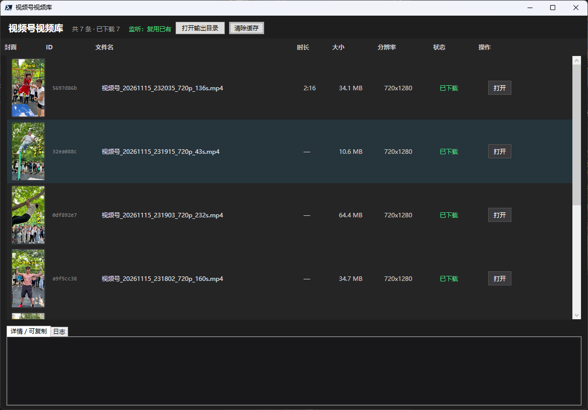
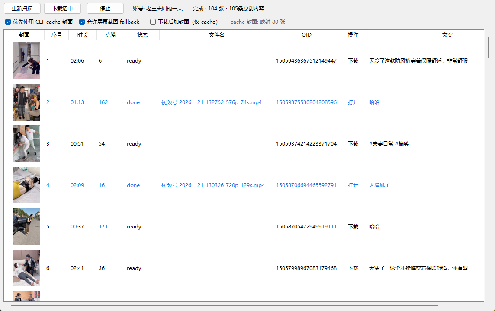

# 使用场景指南：普通用户应该用哪个入口

> **DeepSeek Harness** · 文档整理与验证

本工程有四个入口，名字容易让人误以为：

```text
wx-viewer = 最高级 / 默认
```

实际上不是。

> **`wx-viewer` 是一个“作者主页卡片列表”专用工具，不是全功能主界面。**
> 对大多数普通用户，**首选 `wx-gui.vbs`**。

## 1. 先看结论

| 你的场景 | 用哪个 | 一句话 |
|---|---|---|
| 第一次用，想边看边存 | **`wx-gui.vbs`** | 最推荐，监听 + HUD + 视频库 |
| 不想开视频库，只想自动存 | **`wx-dl.cmd`** | 双击后播放即可 |
| 别人发来的视频卡片/短链 | **`wx-gui.vbs`** 或 **`wx-dl.cmd`** | 点开播放，自动下载 |
| 只想存作者主页里挑中的一条 | **`wx-save.cmd`** 悬停 + F8 | 精确保存，不开视频库 |
| 想看作者主页的完整卡片列表 | **`wx-viewer.vbs`** | 卡列表/封面/逐行下载 |
| 没有代理/证书环境，只有 Python | **`wx-viewer.vbs`** | 不依赖 mitmproxy |
| 想全自动批量下载作者主页 | **`wx-gui.vbs` + 连续播放** | 打开第一张卡，进播放器连播；见 2.1 |

## 2. 普通用户首选：`wx-gui.vbs`



适合：

- 点开视频播放，自动进列表并下载；
- 播放窗口连续播放；
- 别人共享的视频卡片；
- 不想手动挑卡片；
- 想看到封面、时长、大小、状态。

第一次：

```powershell
powershell -ExecutionPolicy Bypass -File setup.ps1
```

然后双击：

```text
wx-gui.vbs
```

**第一次启动后要完全退出微信再打开**，否则微信仍走旧代理。

代价：

- 需要 mitmproxy 证书；
- 会下载播放/预加载到的多条视频；
- 启动/重启微信有一次性配置成本。

### 2.1 全自动批量下载作者主页

这是目前**作者主页批量下载**最顺的路径：

1. 打开作者主页；
2. 点开**第一张卡片**，进入播放窗口；
3. 打开**自动连播/连续播放**；
4. `wx-gui` 视频库会自动出现：
   - 当前正在播放的视频；
   - 预加载的下一条/下几条；
   - 对应下载状态；
5. 你不必等整条播完：
   - 当前条已经开始播放、视频库已经出现并在下载后，可以切下一条；
   - 切得太快，当前条可能只抓到 URL、没有明文头，状态会变成「等待重播」；
6. 看到「等待重播」时，回到该条重播几秒，视频库会自动续上。

经验规则：

```text
不是等“播放完”
而是等“当前条已经出现在视频库，并且开始下载”
```

具体等多久没有固定值，取决于：

- 当前视频是否已经预加载；
- URL/明文头是否已经出现；
- 机器和解码速度。

所以这条路线**需要一点经验**，但不需要看完整个视频。

`wx-viewer` 不能替代这个流程：它只扫作者主页卡片，不负责播放器连播。

## 3. 最轻量：`wx-dl.cmd`

适合：

- 不想开视频库；
- 只要自动下载；
- 能接受控制台。

操作：

1. 双击 `wx-dl.cmd`；
2. 重开微信；
3. 点开视频，播放 3–10 秒；
4. 文件出现在 `我的文档\视频号\`。

这是“什么都不想选”时最简单的自动模式。

## 4. 作者主页精确保存：`wx-save.cmd`

适合：

- 打开作者主页；
- 只想存其中一张卡；
- 不想让工具下载其他视频。

操作：

1. 双击 `wx-save.cmd`；
2. 重开微信；
3. 在作者主页悬停目标卡片 2–3 秒；
4. 按 **F8**。

限制：

- **只对作者主页卡片有效**；
- 播放窗口、聊天里的共享卡片不适用；
- 不要和 `wx-dl`/`wx-gui` 同时占用 8898 端口。

## 5. `wx-viewer.vbs` 到底是干什么的



它是：

```text
作者主页 UIA 卡片列表
+ 封面
+ 时长 / 点赞 / 文案
+ pending / ready / done
+ 每行「下载」
```

适合：

- 想先看到作者主页**所有卡片**；
- 想按文案/时长挑一条；
- 没有 mitmproxy 证书，或不想开代理；
- 想按 oid/index/时长/点赞做跨层绑定；
- 单条下载、逐行操作。

不适合：

- 别人发来的聊天卡片；
- 播放窗口里的视频；
- 想“全自动批量下载作者主页”；
- 想完全不 hover、不播放。

### `wx-viewer` 的真实流程

```text
打开作者主页
→ 扫描卡片（1–3 分钟）
→ renderer/main 绑定 oid/URL
→ ready 或 pending
→ 点某行「下载」
   → 有 seed：直接自解密
   → 没 seed：hover 8 秒 + 明文头
```

它不依赖代理，但依赖：

- Python 3.14；
- `comtypes`、`psutil`、`Pillow`、`requests`；
- 微信作者主页保持打开；
- 扫描期间不要遮挡卡片（主窗口会自动隐藏，左上角有进度窗）。

### 为什么它看起来“高级”但不好用

- 名字叫 viewer，容易误解为“主程序”；
- 它的场景很窄：**作者主页卡片列表**；
- 扫描慢；
- pending 依赖 hover/seed；
- 不能处理聊天卡片/播放窗口；
- 不是全自动批量化工具。

## 6. 场景决策树

```text
视频从哪里来？
├─ 聊天里别人发的卡片 / 短链
│   → wx-gui.vbs 或 wx-dl.cmd
│   → 点开播放，自动下载
│
├─ 作者主页里的一张卡
│   ├─ 只要这一条，且不想开代理
│   │   → wx-viewer.vbs，点该行「下载」
│   └─ 已经有监听环境
│       → wx-save.cmd，悬停 + F8
│
├─ 作者主页的很多条
│   ├─ 想全自动批量
│   │   → wx-gui.vbs：第一张卡 → 播放器连播
│   │     看视频库当前/预加载状态，不必等播完
│   └─ 想先看完整列表再挑
│       → wx-viewer.vbs 逐行下载
│
└─ 只想要最省事的自动下载
    → wx-dl.cmd
```

## 7. 重要限制

- 四个入口不要同时启动；`wx-dl`/`wx-gui`/`wx-save` 会争 8898 端口；
- `wx-viewer` 不需要代理，但不要和监听模式混着理解；
- 所有“可播放文件”都需要明文头或 seed；
- 只 hover 不一定成功；`wx-viewer` 的 seed 分支可以跳过 hover；
- 共享短链在外部浏览器只显示二维码，必须在 Windows 微信聊天里点击；
- 标题不获取、不显示，这是项目决定。

## 8. 普通用户最短路径

如果你不想读上面所有内容：

```text
第一次：
  setup.ps1
  wx-gui.vbs
  完全退出微信再打开

以后：
  点开视频播放几秒
  文件在 我的文档\视频号
```

只有当你需要“作者主页完整卡片列表”时，才打开：

```text
wx-viewer.vbs
```

把它当成一个专用工具，而不是主程序。
