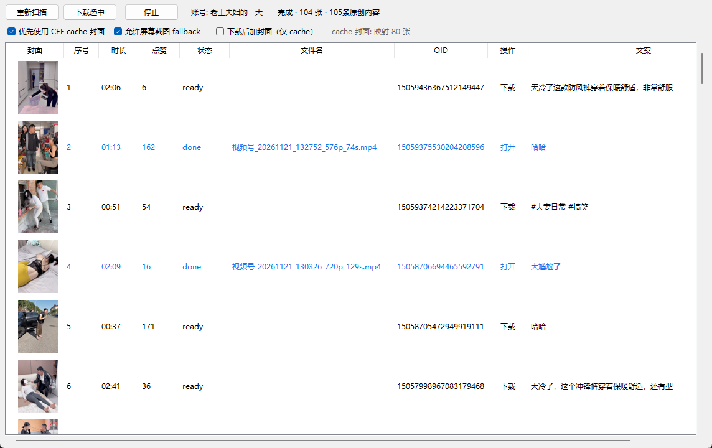

# wx-viewer（本项目版本）

> **DeepSeek Harness** · 文档整理与验证

独立的视频号卡片列表/封面/下载入口，不依赖 `wx-gui`、mitmproxy 或 HUD。

> **它只适合作者主页卡片列表，不是全功能主界面。**
> 普通用户请先看 [使用场景指南](../docs/usage-guide.md)；大多数情况用 `wx-gui.vbs` 更简单。



## 启动

```powershell
wscript wx-viewer.vbs
```

或：

```powershell
pythonw viewer\wx_viewer.py
```

依赖：Python 3.14、comtypes、psutil、Pillow、tkinter、requests、pwsh、curl、ffmpeg/ffprobe。

## 功能

- UIA 卡片：序号 / 时长 / 点赞 / 文案 / 封面 / 状态；
- 每行有「下载」操作；
- 切换视频号账号/作者主页后点「重新扫描」：清空旧列表、强制重扫 renderer/主进程，避免旧账号的 oid/URL 串到新列表；
- `ready` 行：有 seed 则直接自解密；没有 seed 才 hover 8 秒取明文头后下载；
- `pending` 行：点击后自动 hover 8 秒，重扫 renderer/主进程，按 oid/index/时长/点赞重新绑定，成功后再下载；
- 扫描时左上角显示「视频号扫描」进度窗；主窗口暂时隐藏，避免遮住封面；
- 底部日志可选中复制，另有「复制日志」「复制最后错误」按钮；
- 10 分钟内的 renderer/主进程结果会复用，避免每次重扫。

## 跨层绑定

- `mem_render.py`：renderer 堆里的 `oid / index / vid_len / like / 邻近 20302 URL`；
- `main_pairs.py`：主进程 `oid ↔ 完整签名 URL`；
- `resolve.py`：按 **oid → index → 时长 → 点赞** 对齐，歧义拒绝；
- 只有含 `sign + basedata` 的 URL 才进入 `ready`。

## 下载

```text
ready/pending
→ 若该 oid 已有 report decodeKey/seed：直接 ISAAC64 自解密下载（不 hover）
→ 否则 UIA 重新定位卡片
→ hover 8 秒（预览解码，明文头常驻）
→ 匹配 oid / 完整 URL
→ wx-dl 下载密文 + 拼接明文头 + 全片校验
```

seed 自解密使用：

- `seed_scan.py`：扫 `kvReport` 串，得到 `oid → decodeKey`；
- `isaac64.py`：ISAAC64 前缀解密；
- `dl_engine.py --seed`：下载密文 → 解前 131072 字节 → ftyp/moov/mdat + ffprobe/ffmpeg 校验。

实测成功样例：

```text
视频号_20261117_024143_576p_82s.mp4
10,256,192 bytes
duration 82.33s

oid 15050086854154853712 seed 979861605
视频号_20261118_230129_576p_40s.mp4
3,566,401 bytes / 40.22s
```

## 限制

- 扫描会先滚到顶部并逐屏读取；**微信 4.2.0.53 的 CEF 网格可能隔离本地 Python 的合成滚轮/键盘**，但 `find_card` 会用祖先 `class=content` 的 UIA `ScrollPattern` 精确滚到目标卡；只有目标不在当前 UIA 序列/ScrollPattern 不可用时才需要手动滚动；
- 找不到卡片时：确认微信停留在该作者主页，先手动滚到目标卡附近再点下载；日志会列出当前 UIA 的账号、卡片数、同时长/同文案候选；
- renderer/主进程记录只覆盖当前会话/已加载卡片；未命中的卡片是 pending；
- hover 8 秒是经验值；停留更久通常更容易等到 URL/report seed/明文头，但不是硬保证，太长也可能遇到缓存淘汰或限流；有 seed 的 row 不走 hover；
- 明文头是有限缓存，新头会挤掉旧头；
- 同一时间只允许一个下载任务（hover/滚轮/明文头都是全局状态）；
- **hover 暂时不可去掉**：non-hover 的应用层路线已实测关闭；详见 [docs/non-hover.md](../docs/non-hover.md)；
- 不能靠后台/多开播放窗口稳定取明文头；详见 [docs/player-flow-architecture.md](../docs/player-flow-architecture.md)；
- 窗口缩放后按 `uia_key` 重新定位，不依赖旧 rect；
- 图片/图文/直播回放不是普通视频。

## 排查

日志：

```text
viewer/work/viewer.log
viewer/work/resolved_cards.json
viewer/work/main_pairs.json
viewer/work/mem_model2.json
```

扫描阶段和 pending 处理的常见问题见
[docs/known-issues.md](../docs/known-issues.md)。

## 文件

- `wx_viewer.py`：Tkinter UI/扫描/下载编排
- `uia_scan.py`：UIA 卡片读取、`content.ScrollPattern` 滚到目标、封面、定位、hover
- `main_pairs.py`：主进程 `object_id ↔ URL`
- `mem_render.py`：renderer 堆模型（oid/index/时长/点赞）
- `renderer_scan.py`：一次读堆同时抽卡片模型 + decodeKey/seed（比 mem_render + seed_scan 两遍快）
- `resolve.py`：跨层绑定解析
- `seed_scan.py`：从 kvReport 串提取 `oid → decodeKey`
- `isaac64.py` / `dl_engine.py`：seed 自解密与校验
- `../wx-viewer.vbs`：无控制台启动器

